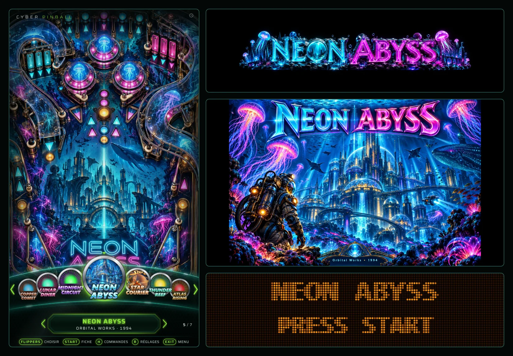
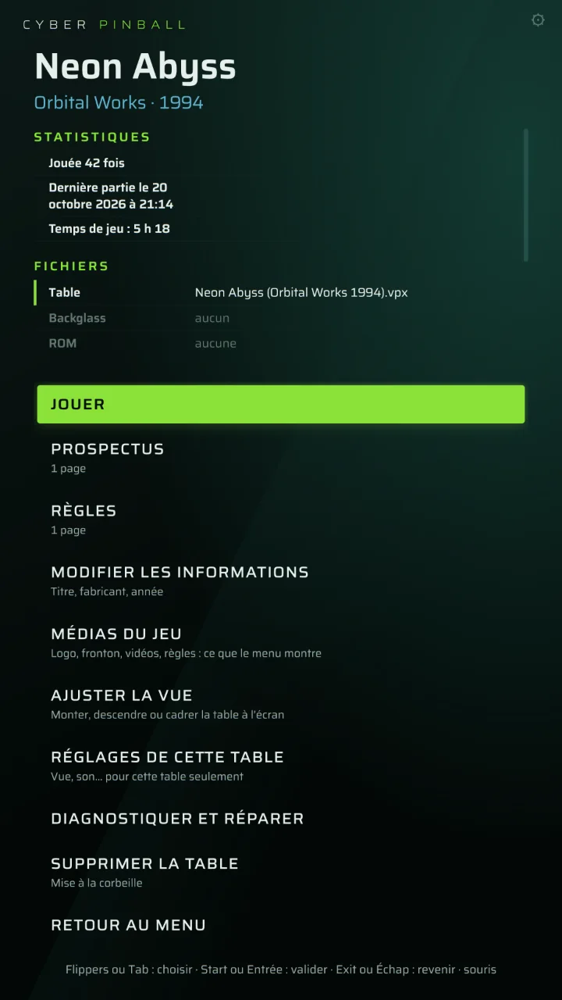
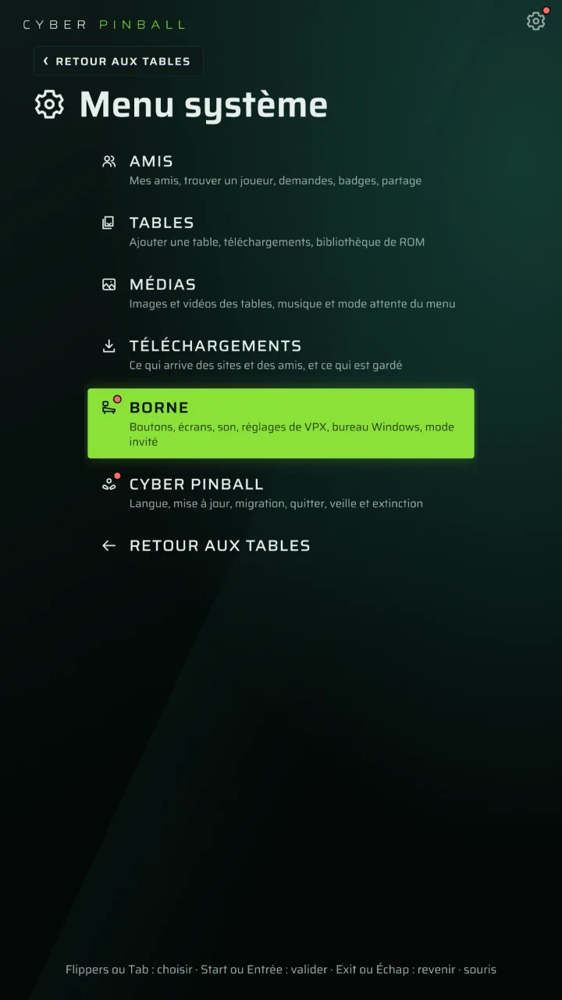
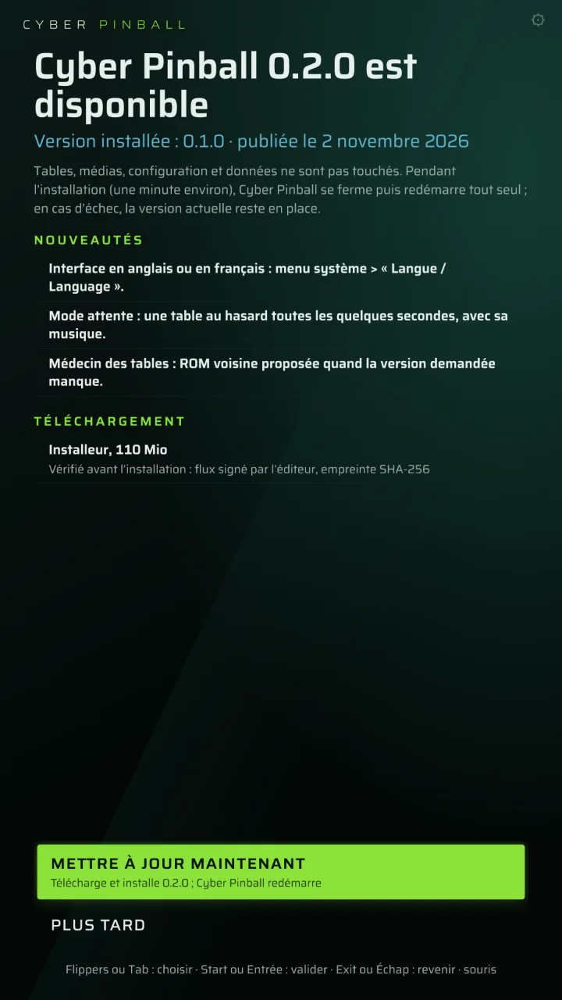
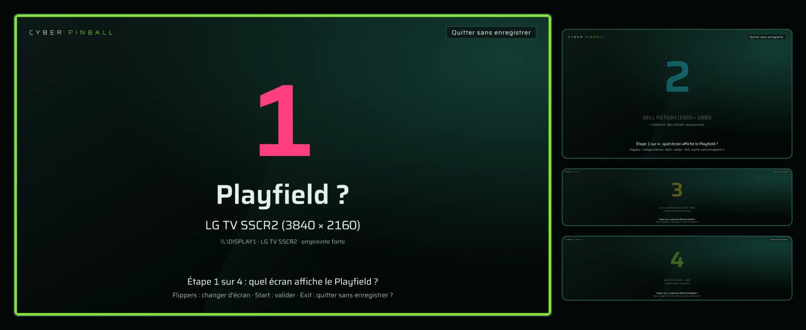
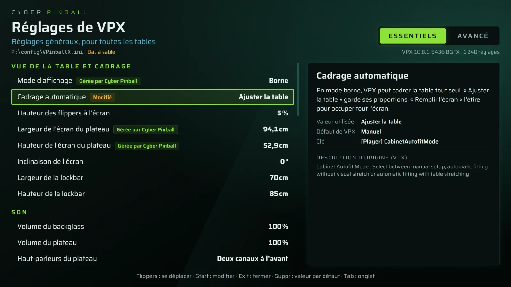

# Cyber Pinball

**Un frontend libre pour borne de flipper virtuel, qui configure toute la borne à partir d'un seul modèle.**

[English](README.md) · [Manuel technique](docs/manuel.md) · [Versions publiées](https://github.com/gocode/cyberpinball/releases) · [Nouveautés](CHANGELOG.md)

On décrit la borne une fois : ses écrans, ses boutons, ses haut-parleurs. Cyber Pinball écrit et tient à jour la configuration de tous les composants : Visual Pinball X, ses plugins de backglass, de PuP et de DMD, la position des écrans, les sorties audio et les touches. Fini les `.ini` édités à la main, fini la borne déréglée quand Windows renumérote les écrans.

> **État : premier prototype (0.1.0).** Windows seulement, pensé pour Visual Pinball X 10.8.1 en mode plugins. Tout n'est pas encore poli : sauvegardez vos tables avant d'essayer.

<p align="center"></p>

## Ce qu'il fait

- **Les écrans, reconnus.** Chaque écran est reconnu par l'empreinte de son EDID, pas par son numéro dans Windows. Un assistant, piloté entièrement aux boutons de la borne, attribue les rôles (playfield, backglass, DMD, topper), le bord des flippers et la diagonale du playfield. `VPinballX.ini` est réécrit à chaque démarrage : la borne résiste aux écrans échangés, renumérotés ou réveillés dans un autre ordre.
- **Plusieurs configurations, une installation.** La même installation peut servir sur un PC de bureau et sur une borne. La configuration branchée est reconnue d'office, chacune avec ses écrans, son son, ses boutons et son `VPinballX.ini`.
- **Le son.** Une étape de l'assistant joue un son sur chaque sortie, fait choisir celle du fronton et celle du plateau, et teste les haut-parleurs d'une carte 5.1 ou 7.1.
- **Un menu des tables fait pour la borne.** Une fenêtre par écran, un menu tourné pour le joueur placé aux flippers, un écran de chargement avec les commandes du jeu, des statistiques de parties, et les erreurs de VPX expliquées en clair. Aucun écran ne montre le bureau Windows, du démarrage à la fin d'une partie.
- **Les tables gérées depuis la borne.** On ajoute des tables depuis un dossier d'import, une clé USB ou le PC ; chacune est nommée d'après la base [Virtual Pinball Spreadsheet](https://github.com/VirtualPinballSpreadsheet/vps-db). Une bibliothèque de ROM range chaque ROM une seule fois, liée dans chaque table qui la joue. L'option de PuP-Pack qui convient aux écrans est choisie d'office, et un « médecin » explique pourquoi une table ne marche pas.
- **Trouver une table.** Un catalogue de la base VPS montre chaque jeu, ses versions et ce qu'il faut à cette borne pour y jouer, avec une liste d'attente des fichiers que l'on télécharge soi-même. Cyber Pinball ne télécharge jamais de tables ni de ROM à votre place.
- **Les médias des jeux.** Logos, vidéos du plateau, frontons, afficheur, topper, vidéos de chargement, musique, prospectus et règles se reprennent de PinUP Popper ou de PinballX, ou se téléchargent à la demande depuis [VPinMediaDB](https://github.com/superhac/vpinmediadb). Chaque média propose aussi ce qu'ont les sites communautaires, avec votre propre compte gratuit : VPForums, puis VPUniverse (dont les comptes gratuits attendent environ 45 secondes par fichier : Cyber Pinball les met en file et attend). Quand un média manque, un repli dessiné par Cyber Pinball prend sa place. Un mode attente est prévu.
- **À côté de PinUP Popper, PinballX ou PinballY.** Cyber Pinball garde tout dans son propre dossier, avec sa copie de VPX et son `VPinballX.ini`, et n'enregistre rien dans Windows. Si un autre menu est ouvert, il attend qu'il soit fermé au lieu de lui disputer les écrans ; il prévient avant de retourner un écran dans Windows, et ne réaffiche que les barres des tâches qu'il a lui-même masquées.
- **Les réglages de VPX sans le `.ini`.** Tous les réglages de VPX, lus dans son propre code source, se changent pour toutes les tables ou pour une seule. Les réglages visuels (cadrage de chaque table, place du fronton, du DMD et du topper) se font sur la table lancée : « Régler l'affichage en partie » ouvre le menu de VPX en pleine partie.
- **La mise à jour depuis la borne.** Menu système > « Mise à jour de Cyber Pinball » cherche la dernière version sur GitHub quand on le demande, montre ses nouveautés, puis la télécharge et l'installe. Chaque version est signée : la borne refuse tout ce qui n'a pas été signé avec la clé de l'éditeur. Tables, médias et réglages restent en place.
- **En français ou en anglais.** Chaque écran suit la langue choisie dans le menu système (« Langue / Language »), dates et nombres compris. Par défaut, Cyber Pinball parle français si Windows le parle, anglais sinon.

## Captures d'écran

Chaque capture est prise hors écran par [`docs/demo-captures.ps1`](docs/demo-captures.ps1), sur une borne simulée (playfield 4K couché, fronton, DMD et topper). Les jeux sont inventés et leurs visuels dessinés par le script.

<p align="center">
  
  
  
</p>

<p align="center"></p>

<p align="center"></p>

## Prérequis

- Windows 10 ou 11, 64 bits.
- Un disque local avec quelques Go libres. Program Files, les dossiers de Windows et les lecteurs réseau sont refusés : VPX et les tables ont besoin d'écrire à côté d'eux.
- Visual Pinball X 10.8.1 : installé pour vous au premier lancement.

## Installation

Téléchargez un installeur sur la page des [versions publiées](https://github.com/gocode/cyberpinball/releases) :

| Fichier | Taille | Visual Pinball X |
| --- | --- | --- |
| `CyberPinball-Setup.exe` | 110 Mio environ | téléchargé au premier lancement depuis sa page officielle, vérifié par SHA-256 |
| `CyberPinball-Setup-complet.exe` | 280 Mio environ | archive officielle incluse, pour une borne sans Internet |

- Tout vit dans **un dossier racine** que vous choisissez (par exemple `D:\CyberPinball`) : l'application dans `app\`, et à côté les tables, médias, configuration, données et émulateurs.
- Pas besoin de droits d'administrateur : l'installation se fait pour l'utilisateur courant.
- Options : un raccourci sur le bureau, et le lancement au démarrage de Windows (borne dédiée). Installation silencieuse : `/S`, `/DEMARRAGE` (lancement au démarrage), `/SANSBUREAU` (pas de raccourci sur le bureau), `/D=D:\Borne` (dossier racine, en dernier et sans guillemets).
- **La désinstallation ne retire que l'application.** Tables, médias, configuration et données restent dans le dossier racine ; une réinstallation au même endroit les retrouve telles quelles.
- Les installeurs ne sont pas encore signés : Windows SmartScreen avertit à leur lancement.

Au premier lancement, Cyber Pinball propose d'installer VPX, puis guide le réglage des boutons, des écrans, du playfield, de la disposition et du son, le tout aux boutons de la borne.

## Mise à jour

Depuis la borne : **menu système > « Mise à jour de Cyber Pinball »**. Rien ne s'installe d'office : Cyber Pinball cherche discrètement une nouvelle version après le démarrage puis toutes les 6 heures, et quand il y en a une, une pastille rouge apparaît sur la roue dentée du menu et sur cette entrée. L'entrée montre alors les nouveautés de chaque version manquée, et l'installe d'un seul bouton si l'on choisit « Mettre à jour maintenant ». Il se ferme pendant l'installation (une minute environ), redémarre tout seul et dit quelle version est installée. Si l'installation échoue, l'installeur remet la version précédente en place.

Chaque version publiée porte un flux signé (`cyberpinball-maj.json`, Ed25519). L'installeur n'est téléchargé que si la signature correspond à la clé livrée dans l'application, et il n'est lancé que si sa taille et son SHA-256 sont les bons. Une préversion (`0.2.0-beta.1`) n'est jamais proposée aux bornes.

## Commandes

Les boutons sont ceux que l'assistant a relevés. En attendant, ce sont les touches qu'envoient d'ordinaire les encodeurs de borne :

| Bouton | Touche par défaut | Menu des tables |
| --- | --- | --- |
| Flipper gauche / droit | Maj gauche / droite | Choisir une table |
| Start | 1 | Jouer |
| Exit | Échap | Menu système (réglages, configuration de la borne, mise à jour, quitter) |
| Clavier | Tab, ou ⚙ à la souris | Menu système, de n'importe où |
| Clavier | Ctrl+Maj+K | Arrêter une partie bloquée |

Pendant une partie, les touches sont celles de la section `[Input]` de VPX, rappelées sur l'écran de chargement.

## Compiler depuis les sources

Il faut Windows 10 ou 11 et Node.js 22 ou plus.

```bash
npm install
npm test            # compile, passe le contrôle de publication et les tests du cœur
npm start           # menu des tables (assistant d'écrans au premier démarrage)
npm run assistant   # assistant complet de la borne
npm run probe       # liste les écrans et les sorties audio détectés
npm run installeur  # fabrique release\CyberPinball-Setup.exe et CyberPinball-Setup-complet.exe
```

`lanceur.cmd` ouvre un menu avec les mêmes actions. Les tests de bout en bout se font sans opérateur et entièrement hors écran : Electron rend en mémoire sur un bureau Windows caché, avec des écrans simulés, et ne prend jamais les écrans du développeur.

| Dossier | Rôle |
| --- | --- |
| `packages/core` | Modèle de borne, empreintes EDID, correspondance des écrans, générateurs INI et VPX, mise à jour. Sans Electron ni Windows. |
| `packages/win-displays` | Fonctions de Windows par FFI (koffi) : écrans, sorties audio, périphériques USB, fenêtres, orientation. |
| `packages/installer` | Manifeste des composants tiers, dossier racine, téléchargements vérifiés, jonctions de version. |
| `app` | L'application Electron : assistant, menu des tables, réglages de VPX, gestion des tables, lancement des parties. |
| `docs` | Manuel technique, scénarios de tests manuels, notes de recherche, design system. |

Le [manuel technique](docs/manuel.md) décrit chaque partie en détail : les fichiers écrits, les commandes, les essais hors écran et les limites connues. Les [scénarios de tests manuels](docs/tests-manuels.md) couvrent ce qui demande une vraie borne. Les deux existent aussi en anglais.

### Publier une version (mainteneurs)

`npm run publier` vérifie que rien de personnel ni de secret ne va partir, fabrique les deux installeurs, signe le flux de mise à jour et envoie un instantané du code sur `main`. Il crée ensuite la release GitHub `v<version>` avec les installeurs et le flux. Les nouveautés viennent de [CHANGELOG.md](CHANGELOG.md) (affichées sur la borne) et de sa traduction [CHANGELOG.en.md](CHANGELOG.en.md) (ajoutée à la release GitHub). Il faut un jeton GitHub à grain fin (`CYBERPINBALL_GITHUB_TOKEN`) et la clé de publication, qui n'est jamais dans le dépôt. La description et les sujets du dépôt viennent du `package.json` et sont appliqués à chaque release, ou par `npm run decrire` (le jeton a alors besoin de la permission « Administration »). Voir [Mise à jour depuis la borne](docs/manuel.md#mise-à-jour-depuis-la-borne) dans le manuel technique.

## Composants tiers et licences

- **Visual Pinball X** ne fait pas partie de ce dépôt. Il est téléchargé depuis ses [versions officielles](https://github.com/vpinball/vpinball/releases) et vérifié contre une empreinte SHA-256 fixée. Sa licence (GPLv3+, et pour certains fichiers une licence dérivée de celle de MAME) n'autorise sa redistribution que gratuitement, hors de tout produit ou activité commerciale. L'installeur complet **ne doit donc être ni vendu, ni livré avec une borne vendue ou exploitée commercialement**.
- La **base VPS** et **VPinMediaDB** ne déclarent aucune licence. Cyber Pinball ne les livre pas : elles sont téléchargées depuis leurs adresses officielles au premier usage. Les médias de VPinMediaDB appartiennent à leurs auteurs et les visuels des jeux à leurs fabricants : **usage personnel, sur sa propre borne** seulement. Les fichiers de VPForums et de VPUniverse se téléchargent avec votre propre compte, un à la fois, à votre demande, et restent sur votre borne : leurs sites interdisent de les remettre en ligne ou de les redistribuer.
- Les polices (Audiowide, Bebas Neue, Orbitron, Press Start 2P, Saira) sont sous licence SIL Open Font License ; leurs licences sont rangées à côté d'elles, dans `app/renderer/polices`.
- Cyber Pinball ne télécharge ni tables ni ROM à votre place. Les tables viennent des sites de leurs auteurs, et les fabricants de flippers n'autorisent pas la diffusion de leurs ROM.

## Licence

La licence de Cyber Pinball lui-même n'est pas encore choisie. Tant qu'un fichier `LICENSE` n'a pas été ajouté, le code est publié pour être lu et essayé, et tous les droits restent à son auteur.
